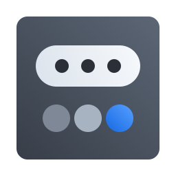

<div align="center">



# Bandeja

Os ícones de bandeja (StatusNotifierItem) do [COSMIC](https://system76.com/cosmic) reunidos
atrás de um botão do painel, vestidos pelo [MeowSystem](https://github.com/vitoriamariadb/MeowSystem).

</div>

## De onde vem

A Bandeja é um fork do **[Status Hub](https://github.com/marcelogomes90/cosmic-ext-applet-status-hub)**,
de **Marcelo Gomes** ([@marcelogomes90](https://github.com/marcelogomes90)). O núcleo da
bandeja, os menus DBusMenu, o tratamento de ícones e a arquitetura (veja
[ARCHITECTURE.md](ARCHITECTURE.md)) são trabalho dele. Este fork muda o nome, completa as
configurações, conserta o clique esquerdo em itens que só têm menu e acrescenta a extensão de
tema do MeowSystem. A licença continua a do original, GPL-3.0-only ([LICENSE](LICENSE)).

## O que faz

- Um botão no painel no lugar de uma fileira de ícones; um clique abre todos num popup compacto.
- Fixe ao lado do botão os que você mais usa; arraste para pôr na ordem que quiser.
- Cada ícone mantém o menu do próprio aplicativo (submenus, marcas, rádio, separadores).
- Um aplicativo que para de responder não trava o painel nem os outros ícones.
- Ícone sai junto com o aplicativo e volta quando ele volta.

## Configurações

Ficam no próprio popup, no botão de engrenagem, em cinco seções:

| seção | o que tem |
| --- | --- |
| Aparência | ícone do botão, posição do botão, ícones na cor do tema |
| Comportamento | o que o clique esquerdo faz, esconder ícones inativos |
| Fixados no painel | cada item da bandeja, com chave para fixar e alça para arrastar |
| Tema | se a extensão do MeowSystem está ativa |
| Sobre | este repositório e o projeto original |

A escolha vale ao clicar em «Concluir» ou ao fechar o popup. As chaves e os valores estão em
[INTEGRACAO.md](INTEGRACAO.md).

## Tema

Sem nada, a Bandeja segue o tema do COSMIC. Um theme pack pode entregar
`~/.config/meowsystem/extensoes/io.github.meowsystem.Bandeja/tema.conf` com cores e ícones
próprios; o contrato está em [INTEGRACAO.md](INTEGRACAO.md#extensão-de-tema).

## Compilar e instalar

Precisa do Rust (edição 2024) e das bibliotecas de desenvolvimento do COSMIC.

```sh
cargo build --release
just install-user      # em ~/.local, sem root
```

Depois adicione a **Bandeja** em Configurações › Área de trabalho › Painel › Applets.

## Desenvolver

```sh
just verify   # fmt, clippy -D warnings, testes e validação dos metadados
```

As traduções são catálogos [Fluent](https://projectfluent.org) em `i18n/<idioma>/status-hub.ftl`
(inglês e português do Brasil). Um teste exige que todo catálogo tenha as mesmas chaves do inglês.

## Licença

GPL-3.0-only, a mesma do Status Hub. Veja [LICENSE](LICENSE).
